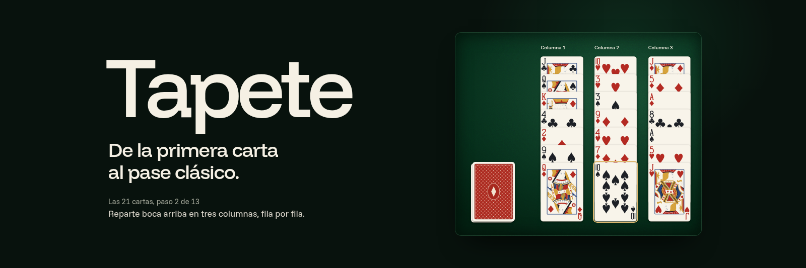

<p align="center">
  
</p>

<p align="center">
  
  
  
  
  
</p>

<p align="center">
  <a href="https://cartomagia-web.vercel.app"><b>Ver el sitio</b></a> &nbsp;•&nbsp;
  <a href="#características">Características</a> &nbsp;•&nbsp;
  <a href="#stack">Stack</a> &nbsp;•&nbsp;
  <a href="#estructura">Estructura</a> &nbsp;•&nbsp;
  <a href="#puesta-en-marcha">Puesta en marcha</a>
</p>

Escuela de cartomagia en español: 17 trucos y 18 técnicas, de los automáticos que hace cualquiera al pase clásico. Cada uno se ve paso a paso sobre un tapete animado con cartas reales, y en los automáticos el tapete reparte de verdad: tú eliges la carta y el truco tiene que funcionar.

## Características

- **Trucos como guiones que se ejecutan.** Un truco es una función que mueve cartas entre zonas y congela cada paso con `snap()`. Cuando hace falta una decisión del espectador, `ask()` deja el paso con la pregunta y corta el guion hasta que respondes; con tu respuesta el guion se vuelve a correr desde el principio con la misma semilla.
- **Cada simulación se prueba.** `npm run check` corre los 26 guiones 200 veces con mezclas distintas, respondiendo como un espectador honesto, y falla si alguno no termina en éxito.
- **Un tapete que se lee.** Las cartas viajan por encima del paquete y se posan. Cuando una entra o sale en medio de una pila, las de encima se abren como un libro para mostrar el punto exacto. La visión de mago marca la carta elegida y las cartas clave, y el encuadre se ajusta a lo que ocupa cada truco.
- **Pantalla completa para practicar.** El tapete y los controles quedan a un lado, la explicación y la lista de pasos al otro, sin scroll. En Android intenta girar la pantalla a horizontal; en iPhone, donde no existe la API, el reproductor igual cubre la página.
- **Videoteca de 141 tutoriales.** Salen de una playlist de YouTube (bajada con yt-dlp) más 55 elegidos de otros canales, clasificados por nivel y tipo de truco. YouTube no carga hasta que tocas el video, y cuando carga usa `youtube-nocookie`.
- **Progreso sin cuentas.** "Marcar como aprendido" vive en `localStorage`; si el navegador no lo deja, sigue funcionando en memoria.

## Stack

| Capa | Tecnología | Por qué |
|---|---|---|
| UI | React 19 + TypeScript | Componentes chicos; el estado de cada truco es un array de pasos |
| Animación | Motion | Interpola entre pasos con keyframes en 3D (altura, giro, volteo) |
| Build | Vite | El sitio es estático; el router es el hash de la URL, sin librería |
| Diseño | Tokens CSS en OKLCH | Una sola paleta (tinta, paño, marfil, lacre, latón) en `src/styles/tokens.css` |
| Lint | oxlint | Reglas de React y TypeScript sin el peso de ESLint |
| Deploy | Vercel | Build de Vite servido como sitio estático |

## Estructura

```
src/
├── engine/           motor, sin React
│   ├── scene.ts      Script: zonas de cartas, snap(), ask()
│   ├── auto.ts       espectador automático para reproducir y verificar
│   ├── view.ts       posición de cada carta y encuadre del tapete
│   ├── cards.ts      mazo, mezcla con semilla
│   ├── faces.ts      caras de naipe en SVG (generado)
│   └── check.ts      npm run check
├── data/
│   ├── scripts.ts    guiones de trucos y técnicas
│   ├── lessons.ts    fichas: nivel, etiquetas, efecto, secreto, videos
│   └── videos.ts     videoteca (generado con yt-dlp)
├── components/       Stage (tapete), Player, Filters, VideoEmbed, Pips, Icons
├── pages/            Home, Library, LessonPage, Videos
├── lib/              hooks (ruta por hash, aprendidos) y filtro de búsqueda
└── styles/           tokens, base y una hoja por área (stage, player, catalog…)
```

## Puesta en marcha

```bash
npm install
npm run dev     # http://localhost:5173
npm run check   # simula cada truco 200 veces
npm run build
```

`npm run check` ejecuta TypeScript directamente con Node, sin compilar, así que necesita Node 22.18 o más nuevo. Los imports llevan la extensión `.ts` por esa misma razón.

## Decisiones

- Los métodos clásicos o de dominio público se explican en la ficha; las rutinas de cada autor se enlazan a sus videos.
- La ruta usa el hash (`#/truco/veintiuna`) para que el build funcione en cualquier hosting estático, sin reglas de reescritura.

Caras de naipe: [cardmeister](https://github.com/cardmeister/cardmeister.github.io) (Unlicense, dominio público).
